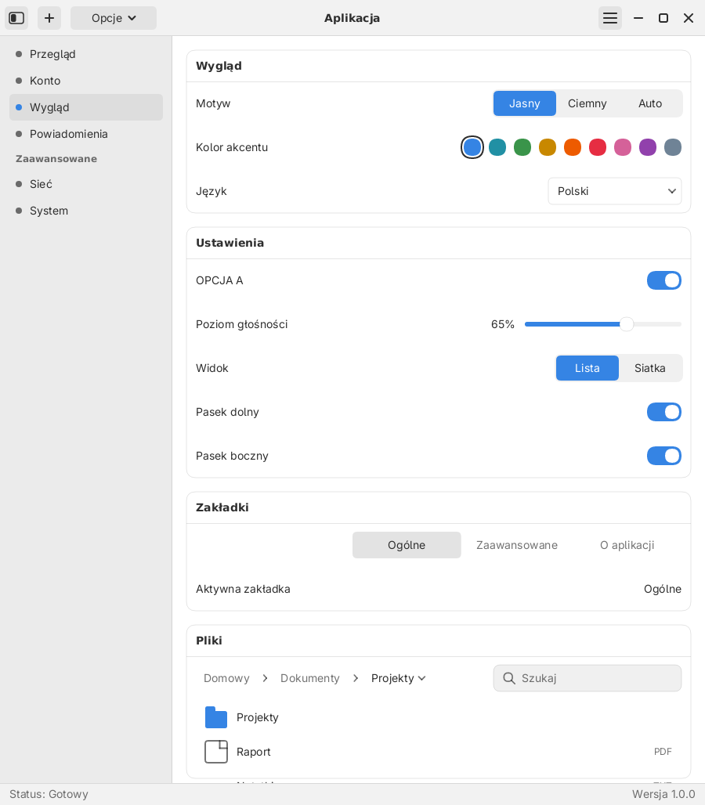
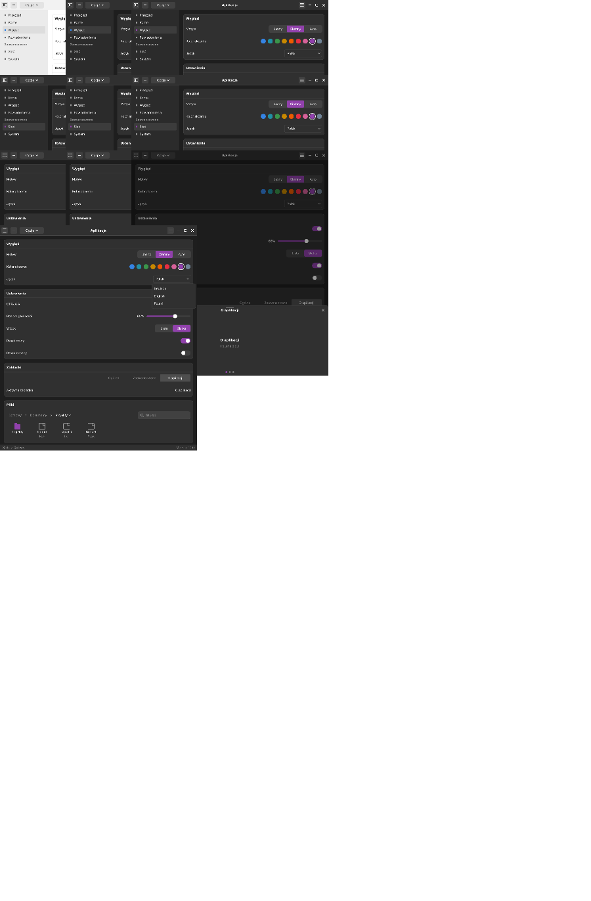
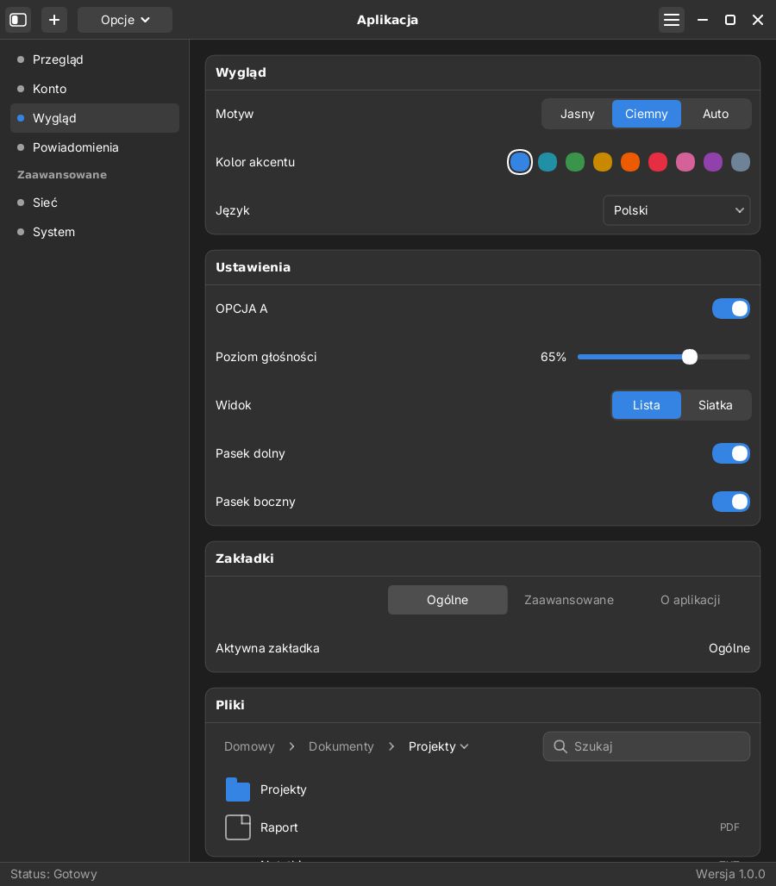
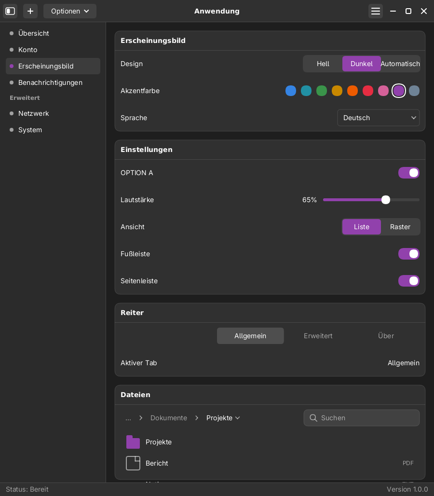
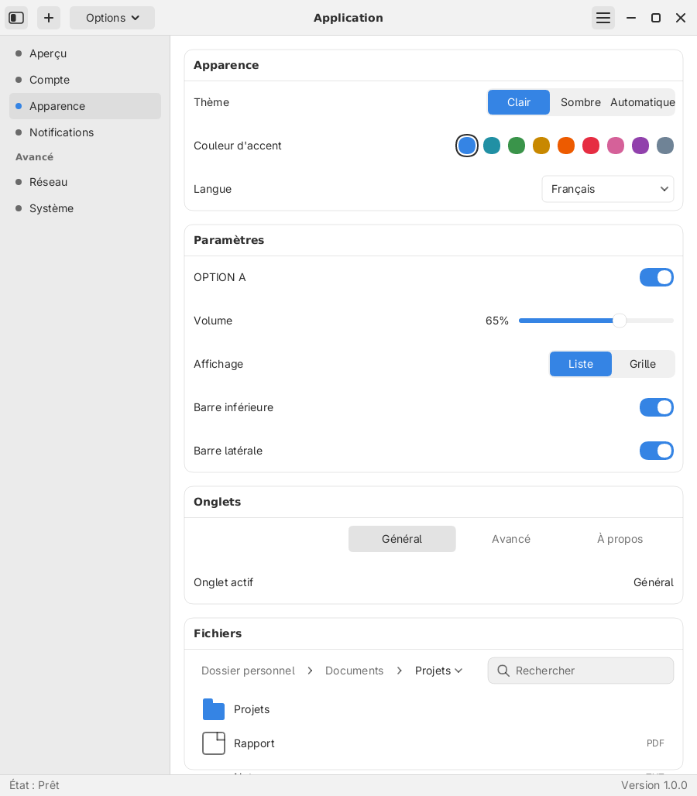

# libLuna

**English** — A lightweight, pure-Rust GUI toolkit: a from-scratch alternative to **GTK4 + libadwaita**, built for the **Luna** desktop.

**Polski** — Lekki zestaw narzędzi GUI w czystym **Rust**: alternatywa od zera dla **GTK4 + libadwaita**, tworzona dla środowiska **Luna**.



> Status: **M0 działające** — fundament, rysowanie, okno Wayland oraz **wielojęzyczność
> i przełączanie wyglądu** (tryb jasny/ciemny/auto, kolory akcentu, metryki kontrolek).
> Repozytorium: <https://github.com/mijsys/libLuna>.

## Why libLuna exists

libLuna exists because building a desktop the way we want it — small, fast, memory-safe and
coherent — is awkward with the options that already exist.

- **GTK4 + libadwaita is capable but heavy.** It drags in the GObject/glib runtime, a large C
dependency tree and manual reference counting. For a lightweight desktop that is more
machinery than the job needs.
- **The alternatives are no better fit.** Qt bindings are enormous; most Rust-native toolkits
(egui, iced, …) are render- or immediate-mode oriented and do not model desktop-shell chrome —
client-side-decorated header bars, sidebars, path bars, tabs, popovers — the way libadwaita does.
- **We want one stack, in pure Rust.** No GObject, no glib, no GTK: just Rust, a scene graph and
a CPU/Wayland backend, with predictable performance and a small binary.
- **We want the looks to be swappable.** Appearance is defined by design tokens — colors *and*
control geometry — so a theme (or a future installed style file) can reshape the UI without
touching widget code.
- **We are building a desktop, not just a widget demo.** libLuna is the UI foundation for the
**Luna** environment (Wayland compositor **Selene**), recreating the GTK4/libadwaita *look and
idioms* without the GTK/Qt bloat.

In short: libLuna is a deliberately small toolkit that gives Luna a fast, memory-safe, cohesive
UI layer it fully controls — written in the language we already build the rest of the system in.

## Dlaczego powstała libLuna

libLuna powstała, bo zbudowanie pulpitu tak, jak chcemy — małego, szybkiego, bezpiecznego
pamięciowo i spójnego — jest niewygodne przy dostępnych obecnie opcjach.

- **GTK4 + libadwaita jest możne, ale ciężkie.** Wciąga runtime GObject/glib, duże drzewo
zależności w C i ręczne liczenie referencji. Dla lekkiego pulpitu to więcej maszynerii, niż trzeba.
- **Alternatywy nie pasują lepiej.** Wiązania do Qt są ogromne; większość natywnych dla Rusta
toolkitów (egui, iced, …) jest nastawiona na render/immediate-mode i nie odwzorowuje „chrome”
pulpitu — pasków tytułu z CSD, pasków bocznych, okruszków ścieżki, zakładek, popoverów — tak jak
robi to libadwaita.
- **Chcemy jeden stos, w czystym Rust.** Bez GObject, bez glib, bez GTK: sam Rust, graf sceny
i backend CPU/Wayland, z przewidywalną wydajnością i małym rozmiarem binarki.
- **Chcemy wymienny wygląd.** Wygląd opisują tokeny — kolory *oraz* geometria kontrolek — więc
motyw (a w przyszłości instalowany plik stylu) może zmienić UI bez dotykania kodu widgetów.
- **Budujemy pulpit, nie tylko demo widgetów.** libLuna to fundament UI środowiska **Luna**
(kompozytor Wayland **Selene**), odtwarzający *wygląd i idiomy* GTK4/libadwaita — bez balastu GTK/Qt.

Krótko: libLuna to celowo mały toolkit, który daje Lunie szybką, bezpieczną pamięciowo i spójną
warstwę UI, w pełni przez nas kontrolowaną — napisaną w języku, w którym budujemy resztę systemu.

## Nazewnictwo

Wzorem GTK / GNOME / Mutter (i Qt / KDE / KWin) rozdzielamy trzy warstwy:

| Warstwa | Odpowiednik GNOME | Odpowiednik KDE | Nasza nazwa |
|---|---|---|---|
| Toolkit (biblioteka) | GTK | Qt | **libLuna** |
| Środowisko / powłoka | GNOME | KDE Plasma | **Luna** |
| Kompozytor Wayland | Mutter | KWin | **Selene** |

To repozytorium to **libLuna** (toolkit). Środowisko **Luna** (powłoka, panele, aplikacje)
i kompozytor **Selene** buduje się na nim.

## Decyzje projektowe

- **Język: czysty Rust** — bez GObject/glib i bez GTK/Qt. Stąd lekkość i bezpieczeństwo
  pamięci; integracja z powłoką odbywa się przez standardowy Wayland (`xdg-shell`,
  a dla paneli `wlr-layer-shell`).
- **Rysowanie: własny stos** — graf sceny + backend CPU (tiny-skia + fontdue). Bez Cairo/Pango.
- **Wielojęzyczność: własna, bez gettext** — kluczem jest angielski napis, więc brak
  tłumaczenia degraduje się łagodnie do angielskiego. **Każdy język to osobny plik**
  `i18n/<kod>.lang`; wbudowane: **pl, en, de**, a kolejne można dołożyć w runtime bez
  rekompilacji (katalogi `~/.config/luna/i18n`, `~/.local/share/luna/i18n`, `/usr/share/luna/i18n`).
- **Kompozytor docelowy: Selene** (Wayland) — jako zwykły klient `xdg-shell`/`wlr-layer-shell`.

## Struktura repozytorium

```
libluna/
  crates/
    libluna/           # fasada: jedno wejście (core + render + platform + widgets + i18n) + prelude
    libluna-core/      # geometria, kolor, skala, zdarzenia, tokeny motywu, ustawienia wyglądu
    libluna-i18n/      # wielojęzyczność: każdy język w pliku i18n/<kod>.lang + przełączanie w runtime
    libluna-render/    # graf sceny + backend software (tiny-skia + fontdue)
    libluna-platform/  # Wayland: xdg-shell (CSD), wl_shm, wejście, pętla zdarzeń, motyw w Frame
    libluna-widgets/   # widgety: ViewSwitcher, NavList, Menu, Button, Switch, Slider, DropDown, HeaderBar, TabBar/TabView, BottomSheet, Pager, PathBar, SearchEntry, ItemView
  apps/
    luna-demo/         # demo aplikacji środowiska Luna; też render offline do PNG
  templates/
    minimal-app/       # szablon startowy aplikacji
  tools/
    libluna-new.sh     # scaffolder: generuje gotowy projekt aplikacji
  docs/                # architektura, roadmap, zrzuty ekranu
```

Mapowanie pojęć GTK/GDK/Gsk/libadwaita → libLuna: [`docs/architecture.md`](docs/architecture.md).
Plan dalszej pracy: [`docs/roadmap.md`](docs/roadmap.md).

## Budowanie i uruchamianie

Wymagany stabilny toolchain Rust. Jeśli go brak:

```bash
curl --proto '=https' --tlsv1.2 -sSf https://sh.rustup.rs | sh
```

```bash
cargo build --workspace
cargo test --workspace
```

Okno z demem (wymaga kompozytora Wayland, np. Selene):

```bash
cargo run -p luna-demo
```

Podgląd bez kompozytora — render do PNG (język, motyw i akcent do wyboru):

```bash
cargo run -p luna-demo --bin render -- --lang pl docs/images/settings-light.png
cargo run -p luna-demo --bin render -- --no-sidebar --sidebar-width 340 /tmp/out.png
cargo run -p luna-demo --bin render -- --dark --accent purple --lang de docs/images/settings-de-dark.png
```

### Demo interaktywne bez kompozytora (headless)

Logika interakcji jest niezależna od Waylanda (bierze zdarzenia + ustawienia), więc da się
ją uruchomić bez okna. „Driver” przepuszcza **prawdziwe zdarzenia** (klik w segment motywu,
w kropkę akcentu, w pozycję nawigacji, w przełącznik widoku, w ikonę `◧`, przeciąganie
krawędzi) przez tę samą funkcję `handle_events` i renderuje klatki:

```bash
cargo run -p luna-demo --bin simulate            # → docs/images/demo-step-*.png + demo-montage.png
cargo test -p luna-demo --test interaction       # te same interakcje jako asercje
```



## Budowanie własnej aplikacji na libLunie

Najszybsza droga to **fasada `libluna`** — jedna zależność zamiast czterech. Trzy sposoby:

```toml
[dependencies]
libluna = { path = "../libluna/crates/libluna" }     # monorepo / sąsiedni katalog
# libluna = { git = "https://github.com/mijsys/libLuna.git" }  # z repozytorium
# libluna = "0.0.1"                                      # z rejestru (docelowo)
```

W kodzie wystarczy `prelude`:

```rust
use libluna::prelude::*;

fn main() -> Result<(), Box<dyn std::error::Error>> {
    set_locale(Locale::from_env());
    let config = AppConfig::new("Moja apka").initial_size(800, 600);
    run(config, |frame: &mut Frame| {
        // frame.events — zdarzenia; frame.scene — graf sceny;
        // frame.theme  — motyw;    frame.measure_text(...) — pomiar tekstu
    })
}
```

### Scaffolder (najszybciej)

```bash
./tools/libluna-new.sh ~/projekty/moja-apka
cd ~/projekty/moja-apka && cargo run
```

Skrypt tworzy projekt z poprawną ścieżką do libLuny. Szablon: [`templates/minimal-app`](templates/minimal-app).

### Działający przykład

```bash
cargo run -p libluna --example minimal
```

> Uwaga: na tym etapie (przed M2) aplikacja wypełnia **graf sceny** ręcznie. Gdy wejdą
> layout i drzewo widgetów, ten sam `run(...)` przyjmie deklaratywne drzewo — kod aplikacji
> stanie się jeszcze krótszy.

## Sterowanie w demo

- **Mysz** — kliknij ikonę **`◧`** w HeaderBarze, aby zwinąć/rozwinąć pasek boczny
  (ikona zmienia się w `▭`), **`☰`** aby otworzyć menu (zamyka się klikiem poza panelem),
  lub kontrolkę **języka** (`DropDown`). Z menu **`☰` → „O aplikacji”** otwiera się **dolny panel**
  (`BottomSheet` z karuzelą stron `Pager`), zamykany klikiem w tło, przyciskiem `✕` lub
  przeciągnięciem w dół. W karcie **Pliki** kliknij element **okruszków** (nawigacja „w górę”),
  **pole wyszukiwania** (fokus) lub **plik/katalog** (zaznaczenie); przełącznik `Lista | Siatka`
  zmienia tryb `ItemView`. Klikaj segmenty `Jasny | Ciemny | Auto`, kropki
  **koloru akcentu**, przełączniki OPCJA A / **Pasek dolny** / **Pasek boczny** i **przeciągaj**
  suwak głośności oraz krawędź paska bocznego (150–460 px). Kontrolki okna `[—][□][✕]` działają
  (minimalizacja/maksymalizacja/zamknięcie przez warstwę platformy).
- **Klawiatura** — skróty: `l` = jasny/ciemny, `a` = następny akcent, `g` = następny język,
  `b` = pokaż/ukryj pasek dolny, `s` = pokaż/ukryj pasek boczny, `v` = widok,
  `o` = dolny panel („O aplikacji”), `Esc` = zamknij.
- Zmiany wyglądu są **zapisywane** do `~/.config/luna/theme.conf` i wczytywane przy starcie.
- Tryb systemowy (`Auto`) czyta zmienną `LUNA_SYSTEM_DARK=1` (docelowo portal D-Bus).

## Własny wygląd (motywy)

Wygląd libLuny to **tokeny**, nie kod widgetów — dlatego „odejście od Adwaty” to głównie
podmiana zestawu tokenów, a nie przepisywanie komponentów. Wygląd opisują trzy warstwy:

1. **Wariant** — `Ciemny / Jasny / Auto` (`ThemePreference`).
2. **Kolor akcentu** (`Accent`, 9 kolorów).
3. **Geometria kontrolek** (`Metrics`) — rozmiary i paddingi widgetów.

Wszystkie tokeny (odstępy, promienie, typografia, **metryki kontrolek**, paleta) żyją
w `Theme` w `libluna-core`. Zmiana wariantu i akcentu jest natychmiastowa, a wybór zapisuje się
w `~/.config/luna/theme.conf`.

### Component metrics

Rozmiary i paddingi kontrolek nie są już stałymi w widgetach, lecz **tokenami**
(`Theme::metrics`) podzielonymi na sekcje per widget: `headerbar`, `button`, `switch`,
`slider`, `dropdown`, `menu`, `nav`, `segmented`, `tabs`, `sheet`, `pager`, `pathbar`, `entry`,
`itemview`. Dzięki temu wygląd steruje **także
geometrią**, nie tylko kolorami — np. `theme.metrics.switch.width` albo
`theme.metrics.headerbar.height`. Widgety czytają te wartości w `paint`/`layout`, więc
przyszły, instalowany styl może zmienić np. wysokość paska tytułu czy rozmiar przełącznika
bez dotykania kodu.

### Plan: style instalowane (jak w GNOME/KDE)

Docelowo wybór wyglądu nie będzie enumem zaszytym w kodzie, lecz **stylem instalowanym jako
plik** — tak jak robią to GNOME i KDE. Aplikacja ma wtedy:

- wykrywać style z katalogów (`~/.local/share/luna/themes`, `/usr/share/luna/themes`),
- pokazywać je na liście w Ustawieniach,
- otwierać **okno podglądu** na żywo przy wyborze (miniatura budowana z realnych widgetów),
- wczytywać tokeny z pliku bez rekompilacji.

Do tego czasu motyw buduje się wprost z tokenów (`Theme::light()` / `Theme::dark()` +
`accented(...)`), więc podmiana palety czy geometrii to kwestia kilku linii.

### Co jeszcze decyduje o „looku GTK4”

Tokeny zmieniają kolory i geometrię kontrolek, ale o tym, czy okno „wygląda jak z GTK4”,
decyduje też **chrome okna**: umiejscowienie kontrolek (`[—][□][✕]`), wyrównanie tytułu,
zaokrąglone narożniki, cień. To warstwa widgetu `HeaderBar` (opcje `ControlsSide`,
`TitleAlign`, `ControlsLayout`) — dzięki temu stronę kontrolek czy wyrównanie tytułu można
zmienić bez przepisywania aplikacji. Rozmiar samych kontrolek okna jest już tokenem
(`theme.metrics.headerbar.control`).

## Dodawanie i edycja języków

Każdy język to **jeden plik** `crates/libluna-i18n/i18n/<kod>.lang`. Format:

```
__name__ = Français          # natywna nazwa języka w UI (opcjonalne)
Appearance = Apparence       # klucz (angielski) = tłumaczenie
# linie zaczynające się od # to komentarze
```

- Wbudowane pliki (`pl`, `en`, `de`) są wkompilowane przez `include_str!`.
- Kolejne języki wystarczy wrzucić jako `<kod>.lang` do `~/.config/luna/i18n`,
  `~/.local/share/luna/i18n` lub `/usr/share/luna/i18n` — zostaną **doładowane przy starcie**
  (nadpisują wbudowane; brakujące klucze spadają do angielskiego).
- Demo przełącza się między wszystkimi wykrytymi językami (klawisz `g` lub klik w „Język”).

Przykładowy, kompletny plik francuski jest w `examples/luna/i18n/fr.lang`:

```bash
XDG_CONFIG_HOME="$PWD/examples" cargo run -p luna-demo --bin render -- --lang fr /tmp/fr.png
```

## Co już działa (M0 + i18n/wygląd)

- `libluna-core`: `Point/Size/Rect/Insets`, `Color` (sRGB, hex), `Scale`, zdarzenia, tokeny
  motywu (`Spacing`, `Radius`, `Typography`), **metryki kontrolek** (`Metrics`) oraz
  **ustawienia wyglądu** (`ThemePreference`, `Accent`, `ThemeSettings` z trwałością
  i rozwiązywaniem `light/dark`).
- `libluna-i18n`: `Locale` (z `LANG`/`LC_*`), `Catalog`, `Translations`, globalne `tr`/`set_locale`,
  makro `t!` z podstawianiem argumentów, **języki z osobnych plików** `i18n/<kod>.lang`
  (wbudowane) oraz **doładowywane w runtime** z katalogów; `languages()` i `language_name()`.
- `libluna-render`: graf sceny (prostokąty, zaokrąglenia, obramowania, linie, clip, tekst)
  i rasteryzator CPU z antyaliasingiem; tekst przez `fontdue` (font Adwaita Sans).
- `libluna-platform`: okno `xdg-shell` z CSD, bufor `wl_shm`, pętla `calloop`, **zdarzenia
  wejścia** (wskaźnik, klawiatura, scroll) w `Frame`, odświeżanie na żądanie, zarządzanie
  motywem przez `Frame::set_preference` / `set_accent` (zapis + natychmiastowe przerysowanie).
  `Frame::close/minimize/toggle_maximize` to **realne akcje okna** (`xdg_toplevel`).
- `libluna-widgets`: **widgety wielokrotnego użycia** w modelu immediate — `ViewSwitcher`
  (segmentowy), `NavList` (menu nawigacji z sekcjami), `Menu` (popover `☰`), `Button`
  (z wariantami i chevronem), `Switch`, `Slider`, `DropDown` (z rozwinięciem przez `Menu`),
  `HeaderBar` (pasek tytułu: tytuł, kontrolki okna, obszar na treść), `TabBar`/`TabView`
  (pasek zakładek i model stron: wybór, dodawanie, zamykanie), `BottomSheet` (dolny panel
  modalny z „grabberem”, przeciąganiem i zamykaniem), `Pager` (karuzela stron z kropkami),
  `PathBar` (okruszki z separatorem `›`, wskaźnikiem `▾` i zwijaniem do `…`), `SearchEntry`
  (pole wyszukiwania: lupka, kursor, czyszczenie) i `ItemView` (pliki/katalogi w siatce lub
  liście, z zaznaczaniem i przewijaniem) oraz wspólny `PaintCtx`.
- `luna-demo`: `HeaderBar` jako widget (tytuł + `[—][□][✕]` po prawej + treść: `◧`, `+`,
  „Opcje ▾”, `☰`); **popover `☰`**, chowany i rozciągany (drag) panel boczny (`NavList`),
  chowany **pasek dolny**, wybór motywu/widoku (`ViewSwitcher`), `Switch`, `Slider`, `DropDown`,
  **zakładki** (`TabBar` + `TabView`) oraz **dolny panel** (`BottomSheet` z karuzelą `Pager`,
  otwierany z menu `☰` → „O aplikacji”), a także kartę **Pliki** (`PathBar` + `SearchEntry` +
  `ItemView` — przełącznik **Widok: Lista | Siatka** zmienia tryb widoku elementów).
- Rozmiary i paddingi kontrolek są **tokenami** (`Theme::metrics`), więc geometria jest tak samo
  „stylowalna” jak kolory — nie ma już stałych typów w widgetach (`HeaderBar::HEIGHT`,
  `Switch::WIDTH`, `Button::HEIGHT`…).

## Zrzuty ekranu

Jasny i ciemny motyw (Luna) oraz wersja niemiecka z fioletowym akcentem i francuska
z pliku doładowanego w runtime:






## Motywacja i kontekst

Środowisko **Luna** (kompozytor **Selene**) ma docelowo zastąpić GTK4/libadwaita w aplikacjach
i ujednolicić warstwę UI w czystym Rust. Bazą jest tu **libLuna**; dotychczasowy świat KartONDE
(powłoka `karton-shell`, aplikacje `karton-settings`/`karton-files`) migruje na libLunę.

## Licencja

MIT
